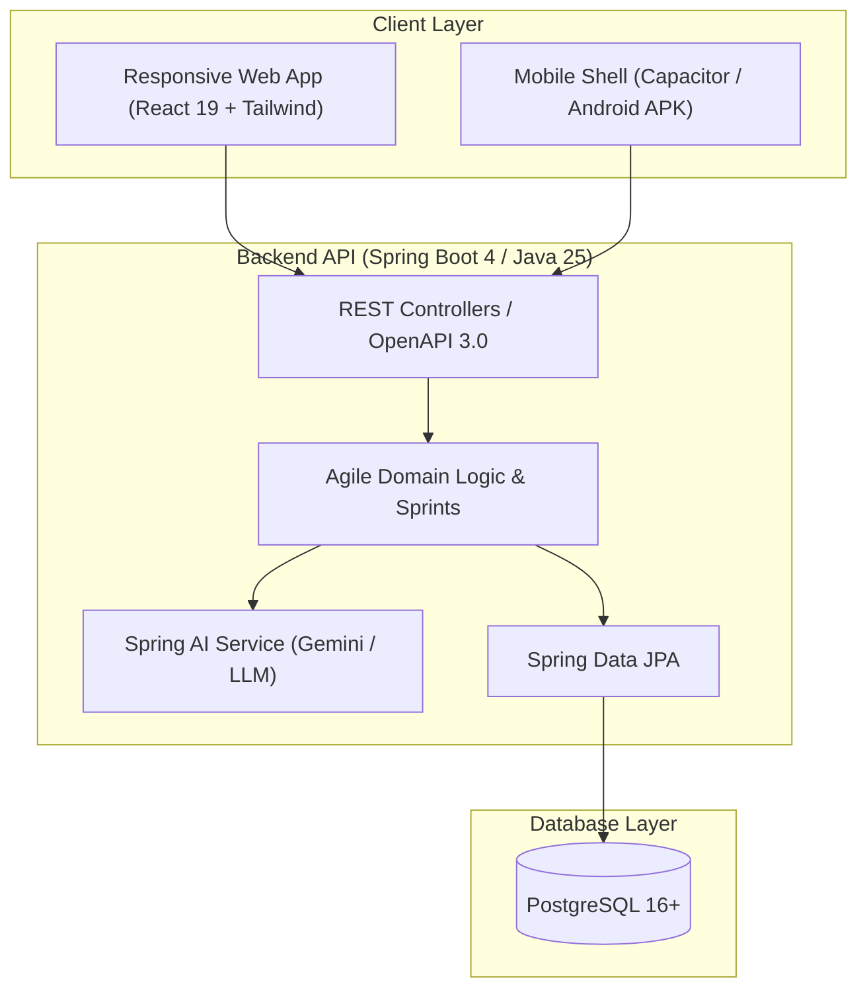

# ⚡ AgileFlow

> A lightweight, high-performance Agile project management application inspired by Rally's work hierarchy and modern Kanban workflows, engineered without enterprise bloat.

[](https://openjdk.org/projects/jdk/25/)
[](https://spring.io/projects/spring-boot)
[](https://react.dev/)
[](https://tailwindcss.com/)
[](https://www.postgresql.org/)
[](LICENSE)

---

## 📖 Table of Contents
- [Why AgileFlow?](#-why-agileflow)
- [Key Features](#-key-features)
- [System Architecture](#-system-architecture)
- [Tech Stack](#-tech-stack)
- [Project Documentation](#-project-documentation)
- [Phased Roadmap](#-phased-roadmap)
- [Getting Started](#-getting-started)
- [License](#-license)

---

## 💡 Why AgileFlow?

Commercial Agile tools like **Jira** and **Rally** serve enterprise corporations with hundreds of compliance configurations, but they are often:
- **Painfully slow** with multi-second page loads and heavy scripts.
- **Overly complex**, requiring 50-field forms just to log a quick bug or feature.
- **Paywalled or missing free tiers** (Rally has no personal free tier).

**AgileFlow** strips away the enterprise overhead and preserves what developers actually need:
- **Clean Item Hierarchy** (borrowed from Rally: `Epic -> Story -> Checklist Task & Defect`).
- **Snappy Drag-and-Drop Kanban** with smooth 60 FPS animations.
- **Mobile-First Experience**: Swipeable column carousel designed for phone viewports.
- **Developer Superpowers**: GitHub commit/PR webhook synchronization, Markdown checklists, and AI-assisted story decomposition.

---

## 🏛 System Architecture



---

## 🛠 Tech Stack

* **Backend**: Java 25 LTS, Spring Boot 4.x, Spring Data JPA, Spring Security, Springdoc OpenAPI
* **Database**: PostgreSQL 16+ (Dockerized)
* **Frontend**: React 19, Vite, TypeScript, Tailwind CSS, `@hello-pangea/dnd`
* **Mobile Wrap**: Capacitor (Android)
* **AI Engine**: Spring AI

---

## 📚 Project Documentation

Detailed architectural and product specifications are maintained in the [`docs/`](docs/) directory:

* 📄 **[Product Requirements Document (PRD)](docs/PRD.md)** — Core scope, user stories, non-goals, and Definition of Done.
* 📐 **[System Architecture & Data Model (ERD)](docs/ARCHITECTURE.md)** — Architectural diagrams, component interactions, and entity relations.
* 📝 **Architecture Decision Records (ADRs):**
  * [ADR-001: React 19 over Angular for Mobile Touch & Bundle Size](docs/adr/ADR-001-frontend-framework.md)
  * [ADR-002: PostgreSQL over NoSQL for Relational Integrity & ACID Sprints](docs/adr/ADR-002-database-selection.md)
  * [ADR-003: Fibonacci Story Points & Relative Sizing Model](docs/adr/ADR-003-estimation-model.md)

---

## 🗺 Phased Roadmap

* **[x] Phase 0: Architecture & Documentation** — PRD, ERD, ADRs, Repository setup.
* **[ ] Phase 1: MVP Core** — Spring Boot 4 CRUD API, PostgreSQL schema, React + Tailwind Kanban board with mobile touch gestures.
* **[ ] Phase 2: Agile Planning & Sprints** — Backlog prioritization view, Sprint lifecycle (Start/Complete), Fibonacci tally.
* **[ ] Phase 3: AI & Git Integration** — AI-generated Acceptance Criteria, Story Splitter, GitHub commit/PR webhooks, Burn-down charts.
* **[ ] Phase 4: Mobile App & Polish** — Capacitor Android build, offline sync, keyboard command palette (`Cmd+K`).

---

## 🚀 Getting Started

### Prerequisites
* **Java 25 LTS**
* **Node.js 22+ & npm**
* **Docker & Docker Compose** (for PostgreSQL)

### 1. Start the Database
```bash
docker compose up -d
```

### 2. Run the Spring Boot Backend
```bash
cd backend
./mvnw spring-boot:run
```
*API Swagger UI will be available at: `http://localhost:8080/swagger-ui.html`*

### 3. Run the React Frontend
```bash
cd frontend
npm install
npm run dev
```
*Application will be available at: `http://localhost:5173`*

---

## 📄 License
This project is licensed under the [MIT License](LICENSE).
