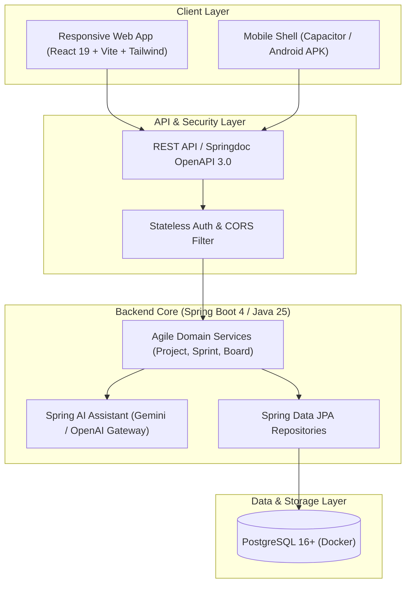
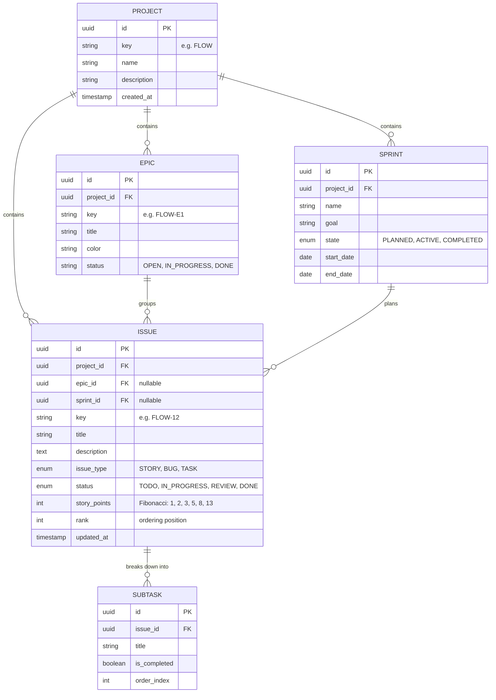

# System Architecture & Technical Design — AgileFlow

**Version:** 1.0.0  
**Stack:** Spring Boot 4.x + Java 25 LTS | React 19 + Tailwind CSS | PostgreSQL 16+  

---

## 1. System Overview & Component Layout

AgileFlow follows a modern, decoupled client-server architecture designed for speed, low memory overhead, and clear API boundaries.

---

## 2. Data Model & Entity-Relationship Diagram (ERD)

The data model maintains clean relational hierarchy inspired by Rally's work breakdowns, guaranteeing referential integrity via PostgreSQL foreign keys.

---

## 3. Technology Stack Justification

| Layer | Selection | Core Rationale |
| :--- | :--- | :--- |
| **Backend** | Spring Boot 4.x + Java 25 LTS | Cutting-edge Java runtime, Virtual Threads for high-throughput I/O, robust Spring ecosystem, and seamless Spring AI integrations. |
| **Persistence** | PostgreSQL 16+ via Spring Data JPA | Enforces referential integrity on hierarchical work items, fast indexed positional reordering, and native `JSONB` flexibility for custom board settings. |
| **Frontend** | React 19 + Vite + Tailwind CSS | Lightweight footprint, instant HMR, superior drag-and-drop touch support (`@hello-pangea/dnd` / `dnd-kit`), and frictionless path to Android via Capacitor. |
| **API Contract** | Springdoc OpenAPI / Swagger UI | Self-documenting REST endpoints generated at runtime directly from Java controllers and DTOs. |
| **AI Integration** | Spring AI | Native Java abstraction over leading LLMs (Google Gemini, Anthropic, OpenAI) for automated acceptance criteria and story breakdown. |

---

## 4. Mobile Responsiveness Strategy

Traditional desktop Agile boards crowd 4 to 6 columns onto a single screen. On small mobile viewports ($< 768\text{px}$), AgileFlow switches to a **Single Column Focus View**:
* A sticky top status tab-bar (`To Do` | `In Progress` | `Review` | `Done`) with indicator badges.
* Horizontal touch-swipe gestures between columns.
* Full touch-handle support for card reordering inside each column.
* Native-like bottom-sheet drawers for quick story editing.
